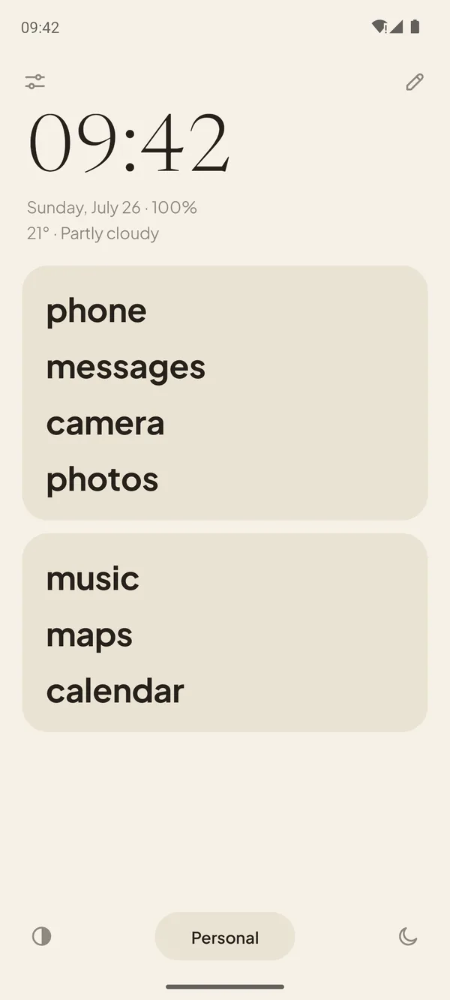
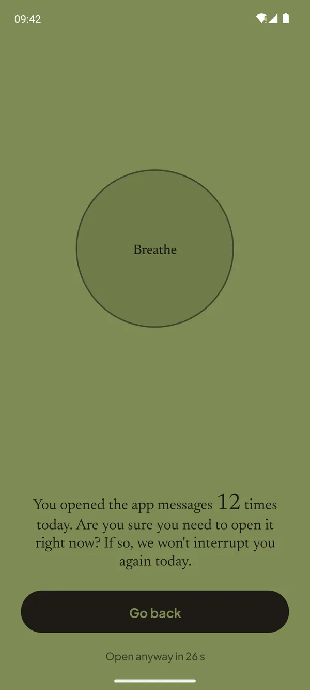
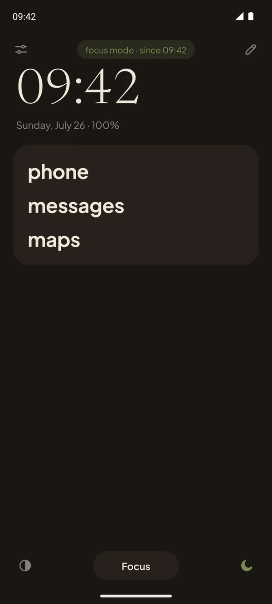

  

<h1 align="center">Pauca</h1>

A calm, text-only home screen for Android, inspired by the iOS Dumb Phone. 
<a href="https://cattastudios.com.br/pauca/">cattastudios.com.br/pauca</a>

  
  
  

## Install

| App | |
| --- | --- |
| [**Pauca**](https://play.google.com/store/apps/details?id=app.pauca) | One-time purchase: focus mode, the breathing pause, weather, unlimited profiles, every theme. |
| [**Pauca Lite**](https://play.google.com/store/apps/details?id=app.pauca.lite) | Free: app cards, the drawer, gestures and two profiles. No internet access. |

## Build

See [BUILDING.md](BUILDING.md). Security issues: [SECURITY.md](SECURITY.md).

## License

GPLv3, see [LICENSE](LICENSE). Pauca is based on [Olauncher](https://github.com/tanujnotes/Olauncher) by Tanuj. The fonts are under the SIL Open Font License, see [licenses/](licenses/).
